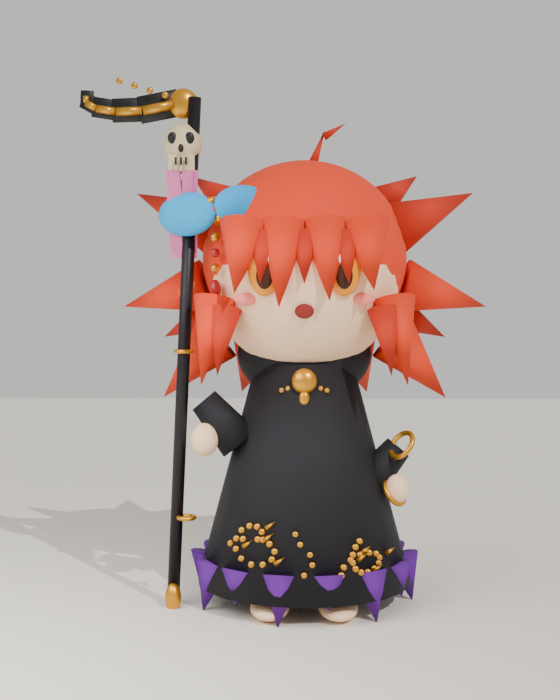

# chibi-reaper

三面図（FRONT / SIDE / BACK）から起こした、ちびキャラ「死神少女」のスタイライズド・ローポリモデル。

## 元画像

- `reference-three-view.jpg` — ユーザー提供の三面図（赤髪、青い大きなリボン、黒＋紫のギザギザ裾マント、ドクロ付き大鎌、裸足）

## 生成方法

- Blender **5.2.4 LTS**、headless の bpy スクリプトで部品ごとに造形（AI の画像→メッシュ一発変換ではない）
- 再生成：`blender -b --factory-startup -P build_model.py`（スクリプト末尾でレンダリング＋書き出しまで実行）
- 色は sRGB → リニア変換して指定。描画は Cycles CPU（EEVEE は実行環境に libEGL が無く使用不可）

## ファイル

| ファイル | 内容 |
|---|---|
| `build_model.py` | 生成スクリプト（唯一のソース） |
| `chibi-reaper.blend` | Blender ソース |
| `chibi-reaper.glb` | glTF バイナリ書き出し |
| `render_front.png` / `render_side.png` / `render_back.png` / `render_hero.png` | プレビュー（560×700、Cycles 48 samples） |

## 既知の割り切り

- スタイライズドな近似造形で、元絵の金刺繍（裾・胸元）や髪の細かい毛束、鎌の装飾彫刻は省略／簡略化
- リギング（ボーン）は無し。ポーズ付けやアニメーションには未対応
- 大鎌の刃は円弧状のセグメント列で近似
