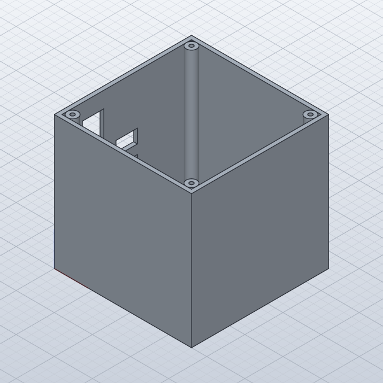
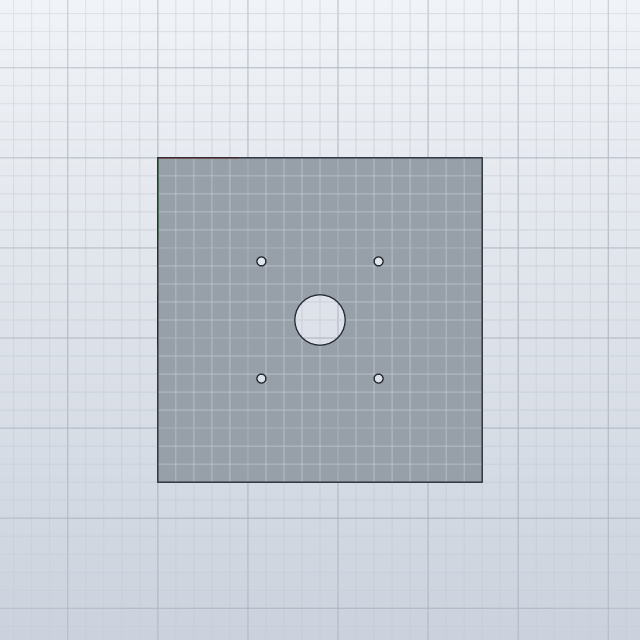
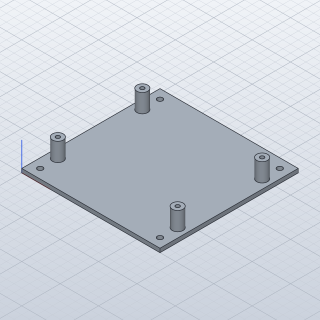

# P4 carrier case — 90mm cube

天網（ESP32-P4 ノード）キャリア基板を収める 90×90×90mm キューブケース。SolidCraft CLI（0.51.2）の JSON コマンドスクリプトで生成。





## 構成

| 部品 | ファイル | 寸法 |
|---|---|---|
| 本体 | `case_body.json` → `case_body.sc` / `.step` / `.stl` | 90×90×87.5mm、壁 2.5mm シェル、背面開口 |
| 蓋 | `case_lid.json` → `case_lid.sc` / `.step` / `.stl` | 90×90×2.5mm 板＋基板スタンドオフ（内側に 12mm 突出） |
| 合体 | — | 87.5 + 2.5 = **90mm** |

## 基板との整合（実測値ベース）

- キャリア基板は `pcb/P4_carrier` の実データから：外形 **86×63mm**、M3 取付穴は **78×55mm パターン**（各辺から 4mm インセット、Ø3.2）
- 基板は蓋側の4本のスタンドオフ（Ø7、高さ 12mm、Ø2.5 下穴）に M3 で固定する方式。基板を蓋に付けてから本体に閉める
- 本体四隅のポスト（Ø7、下穴 Ø2.5）に蓋を M3×4 で締結（蓋側は Ø3.4 バカ穴）

## 前面・側面の開口

- 前面中央：レンズ穴 **Ø14mm**（「レンズは前面中央」の決定に準拠）
- 前面：リングライト取付穴 4× Ø2.5、**PCD 46mm**（FRS5CC Ø52.5 想定の仮値）
- 左側面：通気スリット 3本（14×9mm）＋ RJ45 窓 14×17mm（32088 が基板南辺・RJ45 西向きの現行配置からの推定位置）

## 再生成

```
solidcraft-cli run case_body.json --out case_body.stl --out case_body.step --save case_body.sc
solidcraft-cli run case_lid.json  --out case_lid.stl  --out case_lid.step  --save case_lid.sc
solidcraft-cli eval case_body.sc        # 体積・外形の計測
solidcraft-cli snapshot case_body.sc --out shot.png --view iso
```

座標系：X=幅、Y=高さ、Z=奥行（前面が Z=0、背面開口が Z=87.5）。snapshot の view 名はレンダラ基準（前面パネルは `--view bottom` で見える）。

## 仮置き・未確定

- RJ45 窓の位置はモジュール実配置からの推定。実物合わせで JSON の数値を直すだけ
- リングライト穴 PCD 46 は FRS5CC の取付穴実測がまだ無いので仮値
- 外形のフィレット（角丸）は未適用。印刷時の反り・強度を見て追加する
- カメラモジュール自体の固定ブラケットは未設計（レンズ穴のみ）
